<p align="center">
  
</p>

<p align="center">
  <a href="https://github.com/netspeedy/joflux/actions/workflows/build-and-validate.yml"></a>
  <a href="https://github.com/netspeedy/joflux/releases"></a>
  <a href="https://github.com/netspeedy/homebrew-joflux"></a>
  <a href="https://www.python.org/"></a>
  <a href="LICENSE"></a>
</p>

---

joflux moves the repositories of a GitHub organization into a Forgejo-compatible
instance such as Codeberg. It exports an inventory of the organization, starts a
Forgejo migration for every repository in it, waits for them to finish, checks
what arrived, and archives the GitHub originals once you're happy with the result.

Each of those steps is its own command, and each one writes its results as JSON in
`migration_output/`. You can read exactly what happened, re-run a stage, and keep
the files as the record of the move. joflux is a reworked public version of an
older internal GitHub-to-Codeberg helper, and the default install needs nothing
beyond the Python 3.11+ standard library.

**Quick links:** [Install](#install) · [Try it](#try-it) · [Configuration](docs/configuration.md) · [Usage](docs/usage.md) · [Releases](https://github.com/netspeedy/joflux/releases) · [Website](https://netspeedy.github.io/joflux/)

## Install

On macOS or Linux, Homebrew is the easiest route:

```bash
brew tap netspeedy/joflux
brew install joflux
```

> On recent Homebrew, new third-party taps require explicit trust. If installation is refused, run `brew trust netspeedy/joflux` once, then `brew install joflux`.

Or install it from a checkout with pip:

```bash
python3 -m venv .venv
. .venv/bin/activate
python -m pip install .
```

YAML configs need the optional extra, `python -m pip install '.[yaml]'`. TOML
needs nothing extra.

## Try it

Copy the example config, set your GitHub and Forgejo organizations in it, put both
tokens in the environment, and export the inventory. `export` only reads from
GitHub, so it's the safe first step:

```bash
cp joflux.toml.example joflux.toml
export JOFLUX_GITHUB_TOKEN="ghp_your_github_token"
export JOFLUX_FORGEJO_TOKEN="your_forgejo_token"
joflux --config joflux.toml export
```

It lists the organization and saves the inventory:

```text
02:39:52 - INFO - Fetching repositories from GitHub org: my-github-org
02:39:52 - INFO - Found 14 repositories
02:39:52 - INFO - Inventory saved: migration_output/repos-inventory.json
02:39:52 - INFO - Exported 14 repositories (3 private, 1 forks, 1 archived)
```

Read `migration_output/repos-inventory.json` before going any further. If forks or
already archived repositories shouldn't move, export again with `--exclude-forks`
or `--exclude-archived`; the inventory is the list every later stage works from.

## The five stages

Run the stages in order, all with the same config:

```bash
joflux --config joflux.toml export
joflux --config joflux.toml migrate
joflux --config joflux.toml monitor
joflux --config joflux.toml verify
joflux --config joflux.toml archive
```

| Stage | What it does | Writes |
| --- | --- | --- |
| `export` | Lists every repository in the GitHub organization | `repos-inventory.json` |
| `migrate` | Resolves the target organization and starts one Forgejo migration per repository | `migration-log.json` |
| `monitor` | Polls the target until each started migration completes, fails or runs out of time | `migration-status.json` |
| `verify` | Checks each target repository and records its size and issue, pull request, label and release counts | `verification-report.json` |
| `archive` | Archives the GitHub originals | `archive-log.json` |

`migrate` copies each repository as a normal repository rather than a mirror and
keeps it private if it was private on GitHub. `monitor` only checks repositories
whose migration was started and hasn't finished yet, so you can stop it and run it
again; `--interval` overrides the poll interval for that run. `verify` exits with
code 1 and names the missing repositories if any of them aren't on the target.

`archive` is deliberately separate from the rest. It asks you to type `yes` before
it changes anything, unless you pass `--yes`, and it archives the originals rather
than deleting them.

Every command exits 0 on success, 1 when a stage partly failed or an API call
errored, and 2 for a config problem or a missing state file, so a script can stop
at the first stage that didn't go cleanly.

## Configuration

joflux reads `joflux.toml` by default; `--config` points it elsewhere and
`--log-level` overrides the configured log level for one run.

```toml
[github]
org = "my-github-org"
# token = "ghp_your_github_token"

[forgejo]
url = "https://codeberg.org"
org = "my-forgejo-org"
# token = "your_forgejo_or_codeberg_token"

[migration]
poll_interval = 30
max_wait_time = 3600
log_level = "INFO"
output_dir = "migration_output"
```

The GitHub token needs to list and clone the organization's repositories,
including any private ones you're moving, and to update repository settings if
you'll run `archive`. The Forgejo or Codeberg token needs to create repositories in
the target organization, which must exist before you run `migrate`. Keep both in
the environment as `JOFLUX_GITHUB_TOKEN` and `JOFLUX_FORGEJO_TOKEN` rather than in
the file; for Codeberg, `JOFLUX_CODEBERG_TOKEN` works too. A token in the config
file takes precedence when both are set. For GitHub Enterprise Server, set
`github.api_url` to your server's API address.

Flat keys from the older tool, such as `github_org`, `codeberg_url`,
`codeberg_org` and `codeberg_token`, still work, so an earlier config can be moved
across gradually. [docs/configuration.md](docs/configuration.md) lists every key.

## Before you migrate

Forgejo instances differ in what they allow. Some restrict private imports,
metadata import, how many repositories an organization can hold, or how many
migrations run at once, so check the target's limits before starting on a large
organization. Keep `migration_output/` once the run is over: it's the audit trail,
and it's what `monitor`, `verify` and `archive` read when you re-run them.

## Development

Install the development tools and run the checks:

```bash
make install-dev
make fmt-check
make lint
make test
make smoke
```

`make fmt` formats with black and isort, and `make build` builds the package. The
GitHub Pages site lives in `website/`; `make website-install`, `make website-check`
and `make website-build` cover it. [docs/release.md](docs/release.md) describes the
release flow.

The banner at the top of this page and the social cards are generated. Edit the
copy, layout or timing in `scripts/readme/build_readme_hero.py` and run `make
readme-hero`. That rebuilds `assets/joflux-readme-hero.svg`, the website's
`website/public/og-image.png` and `assets/joflux-social-card.png`, which is the
image for GitHub's social preview and is uploaded by hand in the repository
settings. It runs the script with `uv`, which installs the pinned fontTools it
subsets the fonts with, and renders the cards with headless Chrome or Chromium. The
fonts come from assets.netspeedy.io, so the first run needs network access. If you
change the headline's words, measure them again with `uv run
scripts/readme/measure_headline.py`.

## License

Copyright © 2026 [Simon Oakes](https://github.com/soakes). Released under the
[MIT License](LICENSE).
